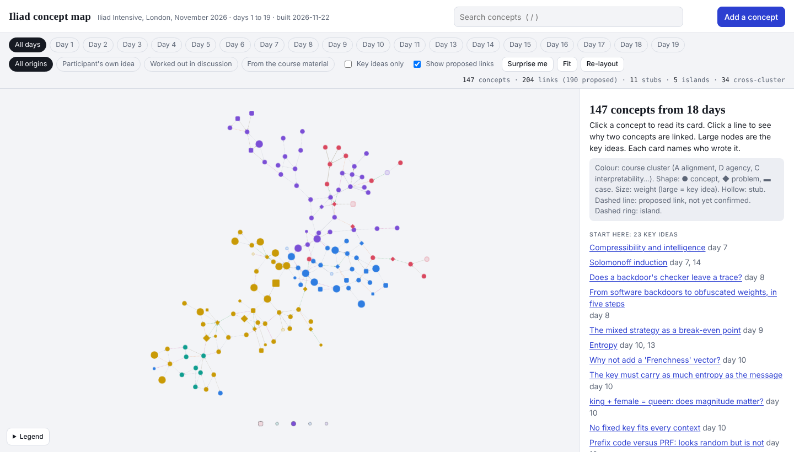

# Iliad concept map

An interactive map of the ideas from the [Iliad Intensive](https://iliad-intensive.org/) (London, November 2026): the course material, and the questions and analogies that participants came up with while studying it.

[](https://mariostsatsos.github.io/iliad-concept-map/)

**Open the interactive map:** https://mariostsatsos.github.io/iliad-concept-map/

The picture above is a still image. Click it, or the link, to open the map itself.

Each idea is one **card** (a small text file). Cards are joined by **links** of six types. The map draws every card as a node and every link as a line.

## Reading the map

| You see | It means |
|---|---|
| Node size | Weight: 1 small, 2 normal, 3 large (a key idea) |
| Node colour | Course cluster: A alignment, B learning, C interpretability, D agency, E safety guarantees |
| Node shape | ● concept, ◆ safety problem, ▬ case (paper, incident, example) |
| Hollow node | Stub: nobody has written its one sentence yet |
| Dashed line | Proposed link that no participant has confirmed yet. Every link drafted by Claude starts as proposed. |
| Dashed ring | Island: a card with no links |

Controls: hover over a node to see its title; click a node to read its card; click a line to see why two cards are linked; filter by day or by origin; tick **Key ideas only** to see the large nodes alone; **Surprise me** (or the `r` key) opens a random card; `/` searches.

## How to add a card (a node)

You need a GitHub account and a browser. Nothing to install.

1. Open the map and click **Add a concept**. GitHub opens a new file that already contains the blank card.
2. **Name the file.** Replace `new-concept.md` with the idea in lowercase words joined by hyphens, for example `loss-plateau.md`. The file name without `.md` is the card's **id**. Other cards use the id to link to yours.
3. **Fill in the header** (the block between the two `---` lines). The attributes are listed in the next section. Only `title` is required.
4. **Write the sentence** under `## In one sentence`, in your own words. The other sections are optional. A card with an empty sentence is shown as a hollow stub.
5. **Link it** to at least one existing card (see "How to add a link").
6. Click **Commit changes**, then **Propose changes**, then **Create pull request**. A check runs on the pull request (for a first-time contributor, GitHub may wait for the maintainer to approve the run). If it turns red, its log names the file and says what is wrong. Once the pull request is merged, the live map rebuilds within a few minutes.

To **edit** an existing card: click its node, then **Edit this card on GitHub**, change the text, and commit in the same way.

To **delete** a card: delete its file, and remove the links that point to it from other cards (the check lists them).

## Card attributes (the header)

```yaml
---
title: "The loss plateau as latent heat"
kind: concept
days: [14]
origin: participant
weight: 3
by: [your-github-name]
links:
  - needs: hidden-progress
---
```

| Attribute | Required | Values | What it does on the map |
|---|---|---|---|
| `title` | yes | any text; put it in quotes if it contains `:` | The node's label |
| `kind` | no, default `concept` | `concept` (idea, definition, result), `problem` (safety problem or failure mode), `case` (paper, incident, scenario, forecast, worked example) | Node shape |
| `days` | recommended | list of course day numbers without quotes, e.g. `[9]` or `[10, 13]` | Day filter; the first day sets the colour. A card with no day is grey and appears only under "All days". |
| `origin` | no, default `notes` | `participant` (your own idea, question or analogy), `chat` (worked out in discussion), `notes` (from the course material), `claude` (added by Claude) | Badge on the card, origin filter, and the default weight |
| `weight` | no | the number `1`, `2` or `3`, without quotes | Node size. If omitted or left blank: `participant` 3, `chat` 2, `notes` 2, `claude` 1 |
| `by` | recommended | list of GitHub names | Credit line on the card |
| `links` | recommended | see below | Lines to other cards |
| `module` | no | course module code, e.g. `B.2` | Overrides the colour that `days` gives |
| `aliases` | no | list of other names | Found by search |
| `load_bearing` | no | `true` | Badge "load-bearing" |

## Card sections (the body)

| Heading | What to write |
|---|---|
| `## In one sentence` | The idea, in your own words. Without it the card is a stub. |
| `## Twist` | What surprised you or is counter-intuitive. |
| `## Why it matters for safety` | One or two lines. |
| `## Open question` | What you could not answer. |
| `## Self-test` | A question a classmate can answer in a minute. |
| `## Notes` | Anything else, for example the answer to the self-test. |
| `## Sources` | A list. Link the module page or paper; do not paste slides. |

Use these headings (capital letters do not matter). A heading that is not in this list is ignored with a warning, and its text does not appear on the map. Any section can be left empty or left out.

An attribute name that is not in the table above (for example a misspelt `orgin`) is also ignored with a warning, so read the check's log even when it is green.

## How to add a link

A link is written on **one** of the two cards, in its `links:` list. The target is the other card's id (its file name without `.md`).

Short form:

```yaml
links:
  - needs: entropy
  - eg: zero-knowledge-proof
```

Long form, when you want to say why:

```yaml
links:
  - to: double-descent
    type: needs
    note: "The analogy is about the peak at d = n."
    proposed: true      # optional: draws a dashed line until someone confirms it
```

| Type | Read "A, type, B" as | Arrow |
|---|---|---|
| `needs` | A needs B: understand B first | A to B |
| `gen` | A generalises B: B is a special case of A | A to B |
| `eg` | A is an example of B | A to B |
| `safety` | A bears on the safety problem B | A to B |
| `tool` | A and B use the same mathematical idea | none |
| `vs` | A and B are in tension | none |

To **confirm** a dashed link, delete its `proposed: true` line. To **reject** it, delete the link and say why in the pull request.

## How to add a new tag value

The allowed values live in `course.yml`. Colours and shapes live in `site/template.html`.

- A new **origin**: add a line under `origins:` with a `label` and a default `weight`.
- A new **link type**: add a line under `link_types:` with `label`, `directed` (`true` draws an arrow) and `help`. Then add a colour for it in `site/template.html` (search for `--e-needs` and add `--e-yourtype` next to it in each of the three places it appears). The card panel then shows the link under its `label`; to give it two phrasings, one for each direction, add a line to the `REL` table in the same file.
- A new **kind**: add a line under `kinds:`. It is drawn as a circle unless you add a shape in `site/template.html` (search for `round-rectangle`). The legend text for shapes is written by hand in the same file (search for `◆ problem`).
- A new **day**: add a line under `days:`. Give it a `module` (such as `B.2`) or a `cluster` letter, otherwise its cards are grey.

## Run it locally (optional)

```sh
pip install -r requirements.txt
python scripts/build.py --check  # checks every card; prints errors with file names
python scripts/build.py          # writes site/dist/index.html; open it in a browser
```

## What is in here

- `concepts/`: one Markdown file per card (`_template.md` is the blank card)
- `course.yml`: days, lecturers, clusters, link types, kinds, origins
- `scripts/build.py`: checks the cards, builds the graph with networkx, writes the page
- `site/template.html`: the interactive page (Cytoscape.js)
- `.github/workflows/`: the check on pull requests, and the publishing of the live map after every change to `main`
- `scripts/publish.sh`: puts the built page on the `gh-pages` branch, which GitHub Pages serves at the address above
- `docs/preview.png`: the still image at the top of this page (a screenshot, replaced by hand)

No slides, PDFs or exercise sheets are stored here. Cards link to the module pages and papers.

## Authors

- Claude (Anthropic): the code, the wording of every card that lists `claude` in its `by:` line, and the first draft of the links, all marked as proposed. Edit them freely.

Every card names its authors in `by:`. Add your name when you edit one.

## Licence

Course material is by the Iliad team, published at [iliad-intensive.org](https://iliad-intensive.org/) under [CC BY 4.0](https://creativecommons.org/licenses/by/4.0/). Cards are CC BY 4.0, by the people named in each card's `by:` field. Code is MIT (see `LICENSE`).
